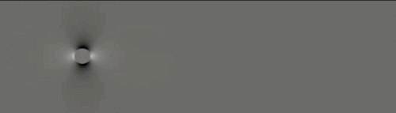

# inc_ns



Cell-centered finite-volume solver for 2D incompressible Navier-Stokes flow on
unstructured triangular meshes, following:

> Amaresh Dalal, V. Eswaran, and G. Biswas, "A Finite-Volume Method for Navier-Stokes
> Equations on Unstructured Meshes," *Numerical Heat Transfer, Part B*, 54: 238-259, 2008.

## Dependencies

### Fluent2DMesh

Mesh I/O (reading Fluent/Gambit `.msh` files) lives in a separate sibling repo,
[Fluent2DMesh](https://github.com/lingzou/Fluent2DMesh), expected to be checked out next to this one:

```
projects/
├── inc_ns/          (this repo)
└── Fluent2DMesh/
```

`CMakeLists.txt` finds it via the `FLUENT2DMESH_DIR` cache variable, which defaults to
`../Fluent2DMesh` relative to this repo -- no editing needed for the side-by-side layout
above. If you check it out somewhere else, point at it explicitly:

```sh
cmake -S . -B build -DFLUENT2DMESH_DIR=<path-to-Fluent2DMesh> ...
```

### PETSc, built with ExodusII support

The solver uses PETSc for its linear solves (KSP) and for output (the `exodusii`
`PetscViewer`). You need to build/install PETSc yourself; this repo does not vendor or
build one. Two things matter about that install:

- It must have ExodusII support, i.e. configured with `--download-exodusii` (or a system
  ExodusII it was pointed at) -- this is *not* the default for many prebuilt/conda PETSc
  packages, since `--download-exodusii` is opt-in. Without it, `PetscViewerExodusIIOpen`
  fails at runtime with something like `"Unknown PetscViewer type given: exodusii"`.
- `PETSC_DIR`/`PETSC_ARCH` need to point at it when you configure this project (either
  as environment variables or `-DPETSC_DIR=...`/`-DPETSC_ARCH=...` on the `cmake` line).

## Build

```sh
cmake -S . -B build -DPETSC_DIR=<path-to-petsc> -DPETSC_ARCH=<petsc-arch>
cmake --build build
```

`compile.sh` is a working example pinned to this machine's own PETSc install -- treat it
as a template, not something to run verbatim elsewhere.

## Run

```sh
./build/inc_exec -i input/cylinder.i
```

Everything is driven by the `-i <file>.i` input file (see **Input file structure**
below). Output is written to `output/`, named from the input file's own basename (e.g.
`cylinder.i` -> `cylinder_out.*`):

- `<problem>_out.e` -- Exodus output (open in ParaView).
- `<problem>_out_<step>.vtu` -- one VTU per time step, kept alongside Exodus for now.
- `<problem>_out_convergence.csv` -- per-time-step L2-error history, one row per step:
  `time_step,u_L2_error,v_L2_error,T_L2_error`. Written every step regardless of
  `-output_interval`. `T_L2_error` is an exact 0 for cases with no temperature B.C.

Regression tests (`exodiff` against `expected/*_out.e`, via SEACAS's `exodiff`):

```sh
./runTests.sh
```

## GUI

```sh
python gui/gui.py
```

A small Tkinter app: `File -> Open` loads an input file into a read-only preview, and
`Run` executes it and live-plots the `u`/`v`/`T` L2 error convergence history (tailing
the CSV above) on a log axis as the simulation progresses. Needs `tkinter` and `matplotlib`; no PETSc or
build step required to just run the GUI itself.

## Input file structure

A case is entirely defined by its `-i <file>.i` input file -- mesh, timestepping, and
every zone's boundary condition -- parsed with PETSc's own options-file mechanism (plain
`-key value` lines, `#` comments allowed). See `input/cylinder.i` and `input/cavity.i`
for complete, working examples. Required top-level keys:

```
-problem    <name>            # a label, for your own reference
-mesh       <path/to/mesh>    # resolved relative to the directory inc_exec runs from
-dt         <time step>
-visc       <kinematic viscosity>
-n_timestep <number of time steps>
```

Optional top-level keys:

```
-output_interval <n>          # write every n-th step to the Exodus file (default 1)
-diff_t          <value>      # thermal diffusivity (default 0)
-T_init          <value>      # uniform initial temperature (default 0)
-buoyancy        <true|false> # Boussinesq buoyancy source in v-momentum (default false)
-gamma           <0..1>       # convective blend factor (default 0.5) -- see below
-newton          <true|false> # monolithic Newton-Krylov solver (default false)
-force_zones     <z1,z2,...>  # track Cf/Cp/Cd/Cl on these wall zones (default: off)
```

### `-gamma`: the convective blend factor

DEB08's upwinding factor. `-gamma` weights the central-difference share of each face
value and `1 - gamma` the first-order upwind share, so **`1.0` is pure central difference
and `0.0` is pure upwind**. The default is `0.5`, i.e. 50% upwinding -- enough numerical
diffusion to matter, so prefer setting it explicitly in any case whose answer you intend
to quote.

How much it matters is strongly problem-dependent, and not in the way you might guess:

| benchmark | `gamma` 0.5 -> 1.0, mesh fixed | mesh refined, `gamma` fixed |
|---|---|---|
| backward-facing step, reattachment length at Re=300 | 5.64 -> 6.65 (**+18%**) | -- |
| lid-driven cavity vs Ghia, max error at Re=3200 | 0.174 -> 0.153 (-12%) | 0.174 -> 0.094 (**-46%**) |

Reference values: Armaly et al. give Lr/S ~ 6.6 for the step, so `gamma = 1.0` is close to
right there and the default alone accounts for a 16% under-prediction. The cavity is the
other way round -- it is resolution-limited, and refining the mesh buys four times what
the blend factor does. The reason is physical: the step's reattachment length is set by
the spreading rate of a free shear layer, which false diffusion attacks head-on, whereas
the cavity's centreline error at high Re is set by thin wall layers and corner vortices.
DEB08 section 4.4 hedges on both causes at once ("the lower-order convective scheme and
smaller mesh size"); the table above says which one dominates where.

Pure central difference (`1.0`) was stable on every case tried here, but it converges to
steady state more slowly than a blended scheme and has no upwind stabilization to fall
back on, so it is not unconditionally safe on coarser or more skewed meshes.

***important***

When `-buoyancy = true`, the simulation is no-longer true transient simulations, while it becomes
a pseudo transient as the code has not been implemented to perform the iteration between temperature field
and the mass-momentum iterations.

Every face zone in the mesh (`inc_exec` prints each as `Face Zone <id>` on startup) must
also have a `-bc_<zone>_type <type>` entry, plus whatever values that type needs:

| type                   | values                                        | meaning |
|------------------------|------------------------------------------------|---------|
| `interior`             | none                                           | shared by two cells; not a boundary |
| `velocity_inlet`       | `-bc_<zone>_u`, `-bc_<zone>_v` (required)      | both velocity components fixed |
| `wall`                 | `-bc_<zone>_u`, `-bc_<zone>_v` (optional, default 0) | no-slip; a *moving* wall (e.g. a lid-driven cavity's lid) is just a `wall` with a non-zero value |
| `horizontal_slip_wall` | none                                           | `v = 0` only, `u` left free |
| `vertical_slip_wall`   | none                                           | `u = 0` only, `v` left free |
| `pressure_outlet`      | `-bc_<zone>_p` (required)                      | fixed pressure |

If no zone provides a pressure B.C. at all (e.g. the lid-driven cavity, walls all the way
around), the pressure equation is only defined up to a constant; the solver detects this
automatically and anchors one cell's pressure to zero, no input-file setting needed.

### Temperature boundary conditions

Temperature is independent of the type in the table above: *any* non-interior zone, of
*any* type, may additionally carry

```
-bc_<zone>_T <value>          # fixed (Dirichlet) temperature on that zone
```

There is no separate `type` for it -- a hot wall is simply a `wall` that also sets
`-bc_<zone>_T`, the same way a moving wall is a `wall` that also sets `-bc_<zone>_u`.

Omit it and the zone is **adiabatic**, i.e. zero gradient.
Currently, a prescribed non-zero heat flux is not supported.

If *no* zone anywhere sets `-bc_<zone>_T`, `T` stays at `-T_init` for the entire run
whatever `-diff_t` is -- which is why both of those keys are optional.

`input/cavity_buoyancy.i` is the worked example -- a differentially heated cavity with
zone 4 hot (`-bc_4_T 1.0`), zone 2 cold (`-bc_2_T 0.0`), and the top and bottom walls
adiabatic by simply not including a `-bc_<zone>_T` line.
