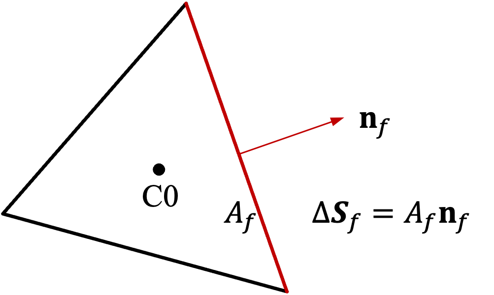
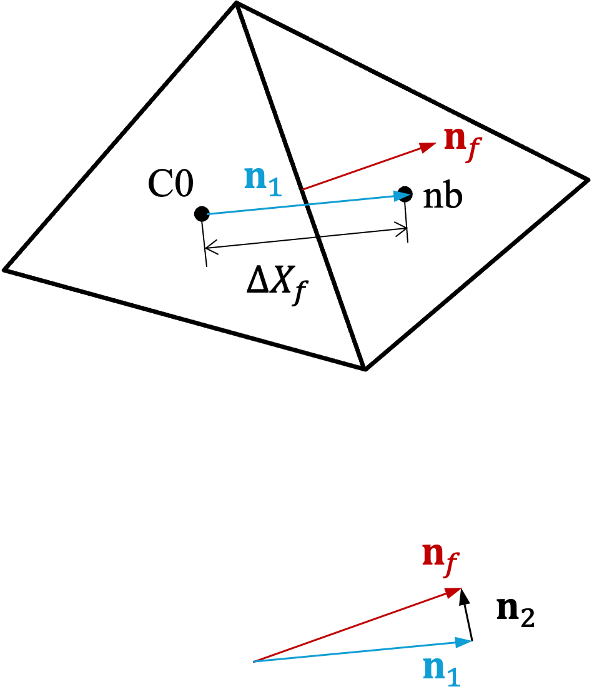

# 2. Dalal-Eswaran-Biswas (DEB08) Method

The segregated solver developed in this work is a direct implementation of the cell-centered,
collocated finite-volume scheme of Dalal, Eswaran, and Biswas (DEB08) for incompressible Navier-Stokes
flow on unstructured triangular meshes.
This section recaps that scheme and then extends it: the governing
partial differential equations, their integral (finite-volume) form and cell-centered discretization, and the
segregated predictor-corrector (Picard/SIMPLE-type) algorithm that advances a time step.
Beyond the original DEB08 formulation, we also cast the discretized equations in symbolic operator form, derive a
fully implicit (monolithic) Newton formulation with a consistent Rhie-Chow face flux, analyze the resulting pressure
Schur complement and show how it recovers the cheap DEB08 pressure-correction operator as a special case, and
discuss how a transported temperature field, with or without buoyancy coupling, is handled by both the segregated
and monolithic algorithms.
The recap of the original scheme is deliberately close to the paper's own notation for
better consistency.

## 2.1 Governing Equations

For an incompressible, Newtonian fluid of constant density $`\rho`$, dynamic viscosity $`\mu`$,
the continuity and momentum equations are:

```math
\nabla \cdot \mathbf{u} = 0,
```

and

```math
\frac{\partial \rho \mathbf{u}}{\partial t} + \nabla \cdot (\rho \mathbf{u} \otimes \mathbf{u}) + \nabla p - \mu \nabla^2 \mathbf{u} = 0,
```

respectively.
In the equations above, $`\mathbf{u}`$ is the fluid velocity vector with
components $`u_i`$ in the i-th direction, respectively.
In this study, we will limit the work on a two-dimensional cases,
and therefore, $`u \equiv u_1`$ and $`v \equiv u_2`$ are the velocity x-component and y-component, respectively.
In this report, these quantities will be used interchangeably.
$`p`$ is the pressure and the kinematic viscosity $`\nu = \mu / \rho`$.

Following DEB08, the integral form of the governing equations
can be expressed in an arbitrary spatial volume $`\Delta V`$ bounded by a closed surface $`\Delta S`$.
The governing equations in the integral form can be expressed as:

Continuity equation:

```math
\int_{\Delta S} \rho \mathbf{u} \cdot \mathbf{dS} = 0
```

General transport equation:

```math
\frac{\partial}{\partial t} \int_{\Delta V} \rho \phi dV + \int_{\Delta S} \left(\rho \mathbf{u} \phi - \Gamma_\phi \nabla \phi \right) \cdot \mathbf{dS} = S_{\phi}.
```

For the momentum equation, using the general transport equation form, $`\phi = u`$ or $`v`$ and $`\Gamma = \mu`$,
and the source term on the right side of equation (general transport equation) is replaced by

```math
-\int_{\Delta V} (\nabla p) \cdot \mathbf{n}_i dV,
```

where $`\mathbf{n}_i`$ is the unit vector in the direction of the velocity component, $`u_i`$.

## 2.2 Discretized Form

To numerically solving the continuity and momentum equations,
we discretize the governing equations using unstructured meshes,
i.e., triangle meshes (cells) in two dimension.
Using collocated method, our purpose is to find the discretized pressure and veolicty values
defined in the center of each cell.

Considering a triangle cell (C0) with a volume $`\Delta V_{C0}`$ closed by three surfaces ($`f`$),
which borders with three neighboring (nb) cells respectively, as depicted in Figure 2.1.

<p align="center">
  
  
  
</p>

*Figure 2.1: (a) Cell-centered triangle mesh; (b) Cell face; (c) Unit vectors.*

In discretized form, the continuity equation for control volume (C0) is

```math
\sum\limits_{f}^{} F_f^{n+1} = 0.
```

in which, $`F_f^{n+1}`$ is the mass flux leaving from volume (C0) at cell face $`f`$
and will be discussed later.

The general transport equation, in discretized form, is given as

```math
\rho \Delta V_{C0} \frac{\phi_{C0}^{n+1} - \phi_{C0}^{n}}{\Delta t} + \sum\limits_{f}^{} (F \phi)_f^{n+1} + \sum\limits_{f}^{} (F_{d, \phi})_f^{n+1} = (S_{\phi})_{C0}^{n+1}.
```

in which, $`(F \phi)_f^{n+1}`$ is the convection term of $`\phi`$ (that leaves from control volume (C0)),
and $`(F_{d, \phi})_f^{n+1}`$ is the diffusion term of $`\phi`$ (that leaves from control volume (C0)),
and $`(S_{\phi})_{C0}^{n+1}`$ is the source term.
All of these three terms will be discussed in details later in
subsection [2.2.1](#221-convection-term) for the convection term,
and subsection [2.2.3](#223-diffusion-term) for the diffusion term, respectively.
Also, note that, compared with the original DEB08 paper,
we used slightly different notations for those term for better clarity.

Following the general transport equation discretized form, the momentum equation is

```math
\rho \Delta V_{C0} \frac{\mathbf{u}_{C0}^{n+1} - \mathbf{u}_{C0}^{n}}{\Delta t} + \sum\limits_{f}^{} (F \mathbf{u})_f^{n+1} + \sum\limits_{f}^{} (F_{d, \mathbf{u}})_f^{n+1} = (\nabla p)_{C0}^{n+1} \Delta V_{C0}.
```

### 2.2.1 Convection term

Following DEB08, we use a weighted average of the upwind (FOU) and central difference (CDS) scheme
for the convection term.
For a face $`f`$, the convection flux of $`\phi`$, $`(F \phi)_f`$, is calculated as

```math
(F \phi)_f = \gamma (F \phi)_f^{CDS} + (1 - \gamma) (F \phi)_f^{FOU}, \qquad 0 \leq \gamma \leq 1,
```

where

```math
(F \phi)_f^{FOU} = [[F_f, 0]] \phi_{C0} - [[-F_f, 0]] \phi_{nb},
```

```math
(F \phi)_f^{CDS} = F_f \cdot \overline{\phi}_f,
```

in which $`\overline{\phi}_f`$ is the face value using volume-weighted linear interpolation
of the two neighboring cells (see below),
and $`[[x, y]]`$ denotes the maximum of the two arguments $`x`$ and $`y`$.

**Face interpolation.** For collocated finite volume method, most variables ($`\mathbf{u}`$, $`p`$, and $`T`$ if applicable)
are defined at cell centers, and therefore their face values are obtained
using volume-weighted linear interpolation:

```math
\overline{\phi}_f = \frac{\Delta V_{nb} \phi_{C0} + \Delta V_{C0} \phi_{nb}}{\Delta V_{nb} + \Delta V_{C0}}.
```

To be consistent with DEB08 notations (see Footnote 1 below),
and to avoid ambiguity when gradient on the surface will be discussed,
we also write this volume-weighted linear interpolation as:

```math
(\overline{\phi_{C0}, \phi_{nb}}) \equiv \overline{\phi}_f.
```

Footnote 1: Here we use $`\overline{\phi}_f`$ for the face interpolation value, while DEB08 uses $`\phi_f`$. We believe that $`\overline{\phi}_f`$ is a better choice to make the document clearer.

### 2.2.2 Gradient term

This subsection discusses the discretized form of a gradient term in a mesh cell,
e.g., the pressure gradient term, $`(\nabla p)_{C0}`$, appeared in the momentum equation.
Assuming that the gradient is constant within a cell, the gradient can be approximated
using the Green-Gauss Theorem, i.e.,

```math
(\nabla \phi)_{C0} = \frac{1}{\Delta V_{C0}} \sum\limits_f^{} \overline{\phi}_f \Delta \mathbf{S}_f
```

in which, $`\overline{\phi}_f`$ is the face value as defined in the face interpolation above,
and $`\Delta \mathbf{S}`$ is the surface area vector, see figure 2.1 (b).
It is noted that the cell-centered gradient term has a four-cell stencil, such that

```math
(\nabla \phi)_{C0} = \begin{bmatrix} \sum c_i \phi_i \\ \sum d_i \phi_i \end{bmatrix},
```

for $`i = \{C0, nb1, nb2, nb3\}`$, and $`c_i`$ and $`d_i`$ are constant values which only depend on
the mesh, i.e., cell volumes, face areas, etc.

### 2.2.3 Diffusion term

The diffusion flux through a cell face $`f`$ (leaving cell (C0)) is

```math
(F_{d, \phi})_f = -\Gamma_{\phi} (\nabla \phi)_f \cdot \Delta \mathbf{S}_f.
```

It is noted that in the equation above, $`(\nabla \phi)_f`$ is NOT the face interpolation value,
$`\overline{(\nabla \phi)}_f`$ in the face interpolation above.
Instead, $`(\nabla \phi)_f`$ is the local gradient ‘sensed’ on the surface.
This is the key to the Rhie-Chow style momentum interpolation as will be discussed later.
Following DEB08's formulation that considers cross diffusion effect, this term is determined as:

```math
\begin{aligned} (\nabla \phi)_f \cdot \Delta \mathbf{S}_f &= A_f (\nabla \phi)_f \cdot \mathbf{n}_f \\ &= A_f (\nabla \phi)_f \cdot (\mathbf{n}_1 + \mathbf{n}_2) \\ &= A_f \left[(\nabla \phi)_f \cdot \mathbf{n}_1 + (\nabla \phi)_f \cdot \mathbf{n}_2\right] \end{aligned}
```

in which, the first term on the right-hand-side is the normal diffusion term,
which can be approximated using the compact two-point scheme;
and the second term is the so-called ‘cross diffusion’as non-orthogonal correction.
For the second term, $`(\nabla \phi)_f`$ is approximated by the face interpolation value $`\overline{(\nabla \phi)}_f`$.
Using the two approximations, the diffusion term can be expressed as,

```math
(\nabla \phi)_f \cdot \Delta \mathbf{S}_f = A_f \left[\frac{\phi_{nb} - \phi_{C0}}{\Delta X_f} + \overline{(\nabla \phi)}_f \cdot \mathbf{n}_2\right].
```

The vectors $`\mathbf{n}_f`$, $`\mathbf{n}_1`$, and $`\mathbf{n}_2`$ are displayed in figure 2.1.
More specifically, $`\mathbf{n}_f`$ is the outward unit normal of the face $`f`$,
$`\mathbf{n}_1`$ is the unit vector joining (C0) centroid to the neighboring (nb) centroid,
and $`\mathbf{n}_2 = \mathbf{n}_f - \mathbf{n}_1`$
and $`\Delta X_f`$ is the distance between the two centroids.

## 2.3 Segregated Solution Algorithm

Now, equations (discretized continuity equation) and (discretized momentum equation), repeated as follows, are the finalized
discretized forms and all the terms are explained/discussed in the previous subsections.

Discretized continuity equation:

```math
\sum\limits_{f}^{} F_f^{n+1} = 0.
```

Discretized momentum equation:

```math
\rho \Delta V_{C0} \frac{\mathbf{u}_{C0}^{n+1} - \mathbf{u}_{C0}^{n}}{\Delta t} + \sum\limits_{f}^{} (F \mathbf{u})_f^{n+1} + \sum\limits_{f}^{} (F_{d, \mathbf{u}})_f^{n+1} = (\nabla p)_{C0}^{n+1} \Delta V_{C0}.
```

Because of the strong coupling between the two equations,
segregated (and iterative) solvers are most commonly used in solving these equations.
Instead of solving the final velocity from the momentum equation,
one typically solves the ‘provisional velocity’ from a modified momentum equation first,
which ignores the pressure gradient or uses a pressure field from a previous iteration,
depending on the exact schemes.
Because the provisional velocity field generally does not satisfy the continuity equation,
the deficit between the provisional velocity field and a divergence-free velocity field
is used to correct the pressure filed,
which is in turn used to get the correct velocity field that satisfie the continuity equation.
In general, iterations are done to ensure all fields converge to the correct final values.

**Provisional velocity.** The DEB08 method could be seen as such an iterative prediction-correction method,
which are elaborated as follows.
First, a ‘provisional velocity’ (“mass velocity” in DEB08) field is solved from modified momentum equation,
which drops the pressure gradient term, however, uses face mass flux from the previous iteration.
More specifically,

```math
\rho \Delta V_{C0} \frac{\mathbf{u}_{C0}^{\ast} - \mathbf{u}_{C0}^{n}}{\Delta t} + \sum\limits_{f}^{} (F^{(i)} \mathbf{u}^{\ast})_f + \sum\limits_{f}^{} (F_{d, \mathbf{u}})_f^{\ast} = 0.
```

in which, the term $`(F^{(i)} \mathbf{u})_f^{\ast}`$ means that the convection term is evaluated
using face mass flux (to be defined) from the previous iteration, $`F_f^{\ast, (i)}`$,
in which the additional superscript $`(i)`$ indicates values from the previous iteration,
and therefore the convection term is linear to $`\mathbf{u}^{\ast}`$.
The diffusion term operates on the current $`\mathbf{u}^{\ast}`$ field, which is also linear.
Clearly, the momentum equation for the provisional velocity field is a linear equation.

**Pressure correction.** As discussed, the provisional velocity field in general will not satisfy the continuity equation.
In particular, if we construct a “provisional face mass flux”, $`F_{0f}^{\ast}`$, using the provisional velocity field, i.e.,

```math
F_{0f}^{\ast} = \rho (\overline{\mathbf{u}_{C0}^{\ast}, \mathbf{u}_{nb}^{\ast}}) \cdot \Delta \mathbf{S},
```

we expect that,

```math
\sum\limits_{f}^{} F_{0f}^{\ast} \neq 0,
```

knowing that $`\mathbf{u}^{\ast}`$ is the solution to the momentum equation without the pressure gradient,
while the correct divergence-free face mass flux, $`F_f^{n+1}`$, considers the pressure gradient.
Clearly, the difference between $`F_f^{n+1}`$ and $`F_{0f}^{\ast}`$ is due to the missing pressure gradient,
and most commonly, the difference is approximated as proportional to the missing pressure gradient,
e.g., $`F_f^{n+1} - F_{0f}^{\ast} \sim d (\nabla p)_f`$, in which the coefficient $`d`$ depends on the exact discretization.
In particular, DEB08 uses the following momentum interpolation:

```math
F_f^{n+1} = F_{0f}^{\ast} - \Delta t (\nabla p^{n+1})_f \cdot \Delta \mathbf{S},
```

citing the Rhie-Chow scheme,
in which $`(\nabla p^{n+1})_f`$ is the face gradient value as discussed in section [2.2.3](#223-diffusion-term),
equation (diffusion flux explicit form), NOT the face interpolation value as defined in equation (face interpolation).
The pressure correction equation can be obtained by substituting equation (face mass flux difference)
into the continuity equation (discretized continuity equation),

```math
\Delta t \sum\limits_f^{} \left( (\nabla p^{\ast})_f \cdot \Delta \mathbf{S} \right) = \sum\limits_f^{} F_{0f}^{\ast}.
```

in which, $`(\nabla p^{\ast})_f \cdot \Delta \mathbf{S}`$ is the “diffusion term”
as described in section [2.2.3](#223-diffusion-term),
therefore, the pressure correction equation is often referred to as the “pressure Poisson equation.”
It is noted that the superscript $`n+1`$ for pressure is repaced by $`*`$ as pressure filed will be updated iteratively,
thus, not final.
In addition, the pressure Poisson equation is linear, and
in two-dimensional triangle mesh, has a maximum 10-cell stencil,
and the coefficients of the linear system are constant values which only depend on the mesh.

**Corrected face mass flux.** After the provisional velocities and corrected pressure field, the corrected face mass flux
can now be obtained re-using equation (face mass flux difference).
We change the superscript from $`n+1`$ to $`\ast`$ to indicate that it still needs iterations
before it can be called the final corrected value:

```math
F_f^{\ast} = F_{0f}^{\ast} - \Delta t (\nabla p^{\ast})_f \cdot \Delta \mathbf{S},
```

During the segregated iterative solving, this is the face mass flux value used
in the provisional momentum equation.

**Summary of the algorithm.** Assuming that time step $`n`$ has been solved, and now we want to find the $`n+1`$ time step solutions.
Following DEB08, the overall solution procedure can be summarized in the following steps:

1. Put $`F_f^{(i)} = F_f^{n}`$ as first guess using previous time step value.
2. Solve the linear provisional velocity equations for $`\mathbf{u}_{C0}^{\ast}`$:

```math
\rho \Delta V_{C0} \frac{\mathbf{u}_{C0}^{\ast} - \mathbf{u}_{C0}^{n}}{\Delta t} + \sum\limits_{f}^{} (F^{(i)} \mathbf{u}^{\ast})_f + \sum\limits_{f}^{} (F_{d, \mathbf{u}})_f^{\ast} = 0.
```

3. Solve the linear pressure correction “Poisson” equation for $`p_{C0}^{\ast}`$

```math
\Delta t \sum\limits_f^{} \left( (\nabla p^{\ast})_f \cdot \Delta \mathbf{S} \right) = \sum\limits_f^{} F_{0f}^{\ast}.
```

4. Update face mass flux $`F_f^{\ast}`$ using

```math
F_f^{\ast} = F_{0f}^{\ast} - \Delta t (\nabla p^{\ast})_f \cdot \Delta \mathbf{S},
```

5. Repeat steps 2, 3, and 4 until $`F_f^{\ast}`$ converges.
6. Put $`F_f^{n+1} = F_f^{\ast}`$ and $`p^{n+1} = p^{\ast}`$, which are the converged face mass flux and cell-centered pressure.
7. Solve the true momentum equation for $`\mathbf{u}_{C0}^{n+1}`$ (now a linear equation)

```math
\rho \Delta V_{C0} \frac{\mathbf{u}_{C0}^{n+1} - \mathbf{u}_{C0}^{n}}{\Delta t} + \sum\limits_{f}^{} (F \mathbf{u})_f^{n+1} + \sum\limits_{f}^{} (F_{d, \mathbf{u}})_f^{n+1} = (\nabla p)_{C0}^{n+1} \Delta V_{C0}.
```

8. End of time step $`(n+1)`$.

## 2.4 Additional Notes

**Symbolic form.** Now, let's revisit the discretized equations in symbolic forms.
For the complete momentum equation, we write

```math
A \mathbf{u} = G p
```

in which, $`A = A(F_f) = M + C(F_f) + D_{\mu}`$,
and $`M = \frac{\rho \Delta V}{\Delta t} I`$, which is linear;
$`C(F_f)`$ is the nonlinear convection operator;
and $`D_{\mu}`$ is the diffusion operator, a discrete analogue of $`-\mu \nabla^2`$, which is linear;
and $`G = \Delta V \nabla`$ is the cell-centered gradient operator, which is also linear.

The key to the DEB08 scheme is to first solve the linearized modified momentum equation,
which can be expressed as:

```math
\left[ M + C(F_f^{(i)}) + D_{\mu} \right] \mathbf{u}^{\ast} = 0
```

which is a linear equation since $`C(F_f^{(i)})`$ is now linear using previous iteration values.

The next step is to solve the pressure correction equation, in symbolic form,

```math
-\Delta t D p = \text{Div} (F_{0f}^{\ast})
```

in which $`D`$ is the diffusion operator, a discrete analogue of $`-\nabla^2`$, and $`D = D_\mu|_{\mu \to 1}`$.
As discussed earlier, $`D`$ is a (max)10-cell stencil linear operator,
which will be a key in providing physics-based preconditioning scheme for the monolithic solver to be discussed in the next section.

As the DEB08 scheme converges, it effectively solves the two equivalent nonlinear equations:

```math
\begin{cases} \text{Div} (F_f) = 0 \\ A \mathbf{u}^{\ast} = 0 \end{cases}
```

with $`F_f = F_f(\mathbf{u}^{\ast}, p)`$.

**What DEB08 momentum interpolation implies.** Comparing the complete momentum equation and the modified momentum equation in (DEB08 symbolic form), it is easy to see:

```math
A(\mathbf{u} - \mathbf{u}^{\ast}) = Gp
```

and

```math
\mathbf{u} - \mathbf{u}^{\ast} = A^{-1}Gp
```

Compared with the DEB08 momentum interpolation equation (face mass flux difference), it is clear to see that DEB08 takes:

```math
A^{-1} \approx M^{-1} = \frac{\Delta t}{\rho \Delta V} I.
```

Physically, $`A^{-1}Gp`$ is the velocity response to a pressure perturbation through the *full*
momentum balance, including transient, convection, and diffusion together;
while $`M^{-1}Gp`$ keeps only the transient part of that response.

Two consequences follow. First, because the $`M^{-1}`$ approximation enters only the face-flux
definitions (face mass flux difference)--(corrected face mass flux) used during
the outer Picard sub-iteration (Steps 2--5), and *not* the final momentum solve (Step 7),
the converged solution $`(\mathbf{u}^{n+1}, p^{n+1})`$ is unaffected by the quality of this approximation:
a poor surrogate for $`A^{-1}`$ slows convergence of the outer loop but does not bias the fixed point
it converges to, since at convergence $`F_f^{(i+1)} = F_f^{(i)}`$ regardless of which surrogate was
used to get there.
Through practice, we have not observed slow outer loop iterations using this approximation.
Second, a cheap, diagonal $`M^{-1}`$ is exactly what keeps the pressure correction
equation (pressure correction) itself cheap: any more accurate (and necessarily
non-diagonal) approximation to $`A^{-1}`$ would turn the pressure equation's compact 10-cell stencil
into a dense, flow-dependent operator, undoing the whole point of the segregated approach: a
linear, geometry-only pressure matrix assembled once. This trade-off reappears, in a more general
form, in the pressure Schur complement discussed below.

## 2.5 Fully Implicit (monolithic) Formulation

In this section, we discuss the fully implicit monolithic formulation,
and Newton's method in solving the fully implicit and coupled system.
In this case, we would like to solve the unknown vector,

```math
\mathbf{U} = \begin{pmatrix} \mathbf u\\ p \end{pmatrix} = \begin{pmatrix} u\\v\\p \end{pmatrix} \in \mathbb{R}^{3N},
```

in a spatially discretized domain with $`N`$ triangle meshes,
for continuity and mass equations (discretized continuity equation) and (discretized momentum equation).
In symbolic form, we write:

```math
\begin{cases} \text{Div} (F_f) = 0 \\ A \mathbf{u} = G p \end{cases}
```

with $`F_f`$ not defined yet.
It is noted that $`F_f`$ here is not the same as in the DEB08 formulation,
which has the provisional velocity, while the monolithic formulation does not have such a variable defined.
The exact formulation of $`F_f`$ in the monolithic formulation will be discussed later.

In residual form, we write:

Discretized continuity equation residual form:

```math
R_c = \frac{1}{\Delta t}\sum\limits_{f}^{} F_f.
```

Discretized momentum equation residual form:

```math
\mathbf{R}_m = \begin{pmatrix} R_u\\ R_v\end{pmatrix} = \rho \Delta V_{C0} \frac{\mathbf{u}_{C0} - \mathbf{u}_{C0}^{n}}{\Delta t} + \sum\limits_{f}^{} (F \mathbf{u})_f + \sum\limits_{f}^{} (F_{d, \mathbf{u}})_f - (\nabla p)_{C0} \Delta V_{C0}.
```

One would immediately notice that the $`1/\Delta t`$ scaling in front for the continuity equation.
Note that it does not change any physics, still solving the same continuity equation.
The reason why this scaling exists will be discussed in the pressure Schur complement section (section [2.5.2](#252-pressure-schur-complement)).

In both residual forms, the superscript $`n+1`$ is dropped for simplicity.
To fully close the system, an explicit (or implicit) formulation for $`F_f`$ is needed.
Intuitively, $`F_f = F_f(\mathbf{u})`$, or $`F_f = F_f(\mathbf{u}, p)`$.
DEB08 did not provide such a formulation, however, a correct formulation of Rhie-Chow type
of face mass flux can be obtained following similar approaches used in DEB08.

First, the most straightforward but naive formulation is:

```math
F_f = F_f(\mathbf{u}) = \rho (\overline{\mathbf{u}_{C0}, \mathbf{u}_{nb}}) \cdot \Delta \mathbf{S},
```

but this is a well understood trap that leads to the checkerboard pressure oscillations.
As a well-understood fact, a correct Rhie-Chow type of face mass flux needs the correct pressure gradient terms.
Recall that the momentum interpolation equation used in DEB08 states that:

```math
F_f^{n+1} = \rho (\overline{\mathbf{u}_{C0}^{\ast}, \mathbf{u}_{nb}^{\ast}}) \cdot \Delta \mathbf{S} - \Delta t (\nabla p^{n+1})_f \cdot \Delta \mathbf{S},
```

Naturally, we extend the same interpolation in cell center for velocity, such that

```math
\mathbf{u}_{C0} = \mathbf{u}_{C0}^{\ast} - \frac{\Delta t}{\rho} (\nabla p)_{C0}.
```

Substituting equation (cell velocity difference) into (momentum interpolation equation),
it can be obtained:

```math
\begin{aligned} F_f &= \rho \left(\overline{\mathbf{u}_{C0} + \frac{\Delta t}{\rho} (\nabla p)_{C0}, \mathbf{u}_{nb} + \frac{\Delta t}{\rho} (\nabla p)_{nb}} \right) \cdot \Delta \mathbf{S} - \Delta t (\nabla p)_f \cdot \Delta \mathbf{S}, \\ &= \underbrace{\rho (\overline{\mathbf{u}_{C0}, \mathbf{u}_{nb}}) \cdot \Delta \mathbf{S}}_{(1)} - \underbrace{\Delta t (\nabla p)_f \cdot \Delta \mathbf{S}}_{(2)} + \underbrace{\Delta t \overline{(\nabla p)}_f \cdot \Delta \mathbf{S}}_{(3)} \\ &= \rho (\overline{\mathbf{u}_{C0}, \mathbf{u}_{nb}}) \cdot \Delta \mathbf{S} - \Delta t \left[(\nabla p)_f - \overline{(\nabla p)}_f \right] \cdot \Delta \mathbf{S}. \end{aligned}
```

This is the classic Rhie-Chow type face mass flux for the monolithic formulation.
The first term (1) is the ‘naive’ formulation using neighboring cell velocities;
the second term (2) is the pressure gradient ‘sensed’ on the face, see definition/implementation in
section [2.2.3](#223-diffusion-term);
and the third term (3) is the averaged neighboring cell pressure gradient on the face,
see definitions in section [2.2.2](#222-gradient-term) and section [2.2.1](#221-convection-term).
Terms (2) and (3) together, is the appropriate correction term, which brings the correct pressure information to the face flux.
The two terms can be further manipulated such that

```math
F_f = \rho (\overline{\mathbf{u}_{C0}, \mathbf{u}_{nb}}) \cdot \Delta \mathbf{S} - \Delta t A_f \left[ \frac{p_{nb} - p_{C0}}{\Delta X_f} - \overline{(\nabla p)}_f \cdot \mathbf{n}_1 \right].
```

The correction term now has much clearer physics picture.
It is the difference between the two pressure gradient interpolations on the face: a compact two-point pressure gradient,
and an average of neighboring cell pressure gradient.
The correction term is precisely designed for the job: it vanishes on a smooth pressure field,
while ‘explodes’ on a checkerboard pressure field.
For this topic, one should refer to the book by Moukalled, et al. (2015),
who may have the best explanation to the Rhie-Chow scheme.

### 2.5.1 Newton linearization

Newton's method solves, at iteration k,

```math
J(\mathbf{U}^k) \delta \mathbf{U}^k = -R(\mathbf{U}^k), \qquad \mathbf{U}^{k+1} = \mathbf{U}^{k} + \delta \mathbf{U}^k, \qquad J = \frac{\partial R}{\partial \mathbf{U}}
```

For the monolithic formulation, the Jacobian has the following structure:

```math
J = \begin{pmatrix} \frac{\partial \mathbf{R}_m}{\partial \mathbf{u}} & \frac{\partial \mathbf{R}_m}{\partial p}             \\ \frac{\partial R_c}{\partial \mathbf{u}} & \frac{\partial R_c}{\partial p} \end{pmatrix} = \begin{pmatrix} Q & G'             \\ \frac{\rho}{\Delta t} \text{Div} & L_{pp} \end{pmatrix}
```

in which, $`Q = A + \mathbf{u} \partial A/\partial \mathbf{u}`$,
$`G' = G + g`$ with $`G`$ the cell-centered gradient operator in matrix form,
and $`g`$ is trivial from the contribution of pressure correction terms
(see the discussion of $`L_{pp}`$ being nearly null below);
Div the divergence operator in matrix form,
and $`L_{pp}`$ is the partial derivative of the ‘divergence of pressure correction term’
with repsect to pressure $`p`$ in matrix form.
Both blocks in the second row already carry the $`1/\Delta t`$ from the normalized continuity residual.
As discussed, $`L_{pp}`$ is nearly null on smooth modes by design,
and therefore, the structure of the Jacobian represents the saddle point problem familiar to us.
It is noted that, the divergence of pressure correction term carries the same $`\Delta t`$ prefactor
as the face mass flux it comes from, and that $`\Delta t`$ now cancels against the $`1/\Delta t`$ already in front of $`R_c`$,

```math
\frac{1}{\Delta t}\left[-\Delta t \text{Div} (\nabla p)_f + \Delta t \text{Div} \overline{(\nabla p)}_f\right] = D p + \frac{1}{\Delta V} \text{Div} \overline{G} p,
```

and thus

```math
L_{pp} = D + \frac{1}{\Delta V} \text{Div} \overline{G},
```

recall that $`D = -\nabla^2`$ and $`G = \Delta V \nabla`$.

### 2.5.2 Pressure Schur complement

The saddle-point problem (Jacobian structure) can be solved directly, e.g. with a sparse LU factorization,
but it can also be reduced, exactly, to a problem in $`\delta p`$ alone by block elimination, the
same manipulation used throughout the saddle-point literature for Stokes and Navier-Stokes systems.
Writing the Newton update as $`\delta \mathbf{u}`$ and $`\delta p`$,
the two block rows of the Jacobian system read

```math
Q\,\delta \mathbf{u} + G'\,\delta p = r_u, \qquad \frac{\rho}{\Delta t}\text{Div}\,\delta \mathbf{u} + L_{pp}\,\delta p = r_c,
```

with $`r_u`$ and $`r_c`$ the (negative) momentum and continuity residuals.
Choosing a reasonable time step size, $`Q`$ is diagonally dominant with a positive diagonal and invertible,
and the first equation can be solved for $`\delta \mathbf{u}`$:

```math
\delta \mathbf{u} = Q^{-1}\left(r_u - G\,\delta p\right)
```

It is noted that $`G'`$ has been approximated by $`G`$ with the trivial term $`g`$ dropped.
Now, substituting the ‘barred’ face interpolation value of $`\delta \mathbf{u}`$ into the second equation
(the face interpolation value is used because the second equation acts on faces),

```math
\frac{\rho}{\Delta t} \text{Div} \left[ \overline{Q^{-1}}r_u - \overline{Q^{-1} G} \delta p \right] + L_{pp}\,\delta p = r_c.
```

and then,

```math
\underbrace{\left[L_{pp} - \frac{\rho}{\Delta t} \text{Div} \overline{Q^{-1} G} \right]}_{S}\delta p = \text{RHS}.
```

in which, $`S = L_{pp} - \frac{\rho}{\Delta t} \text{Div} \overline{Q^{-1} G}`$ is the pressure Schur complement.
The question is, what is a cheap but still accurate approximation to it?

**The cheap surrogate is already in hand.**
The momentum-interpolation analysis above showed that DEB08 approximates $`A^{-1}`$, and by the same
argument $`Q^{-1}`$, with the diagonal $`M^{-1} = \frac{\Delta t}{\rho \Delta V}I`$.
Substituting this surrogate into the Schur complement, and recall that $`L_{pp} = D + \frac{1}{\Delta V} \text{Div} \overline{G}`$,

```math
\begin{aligned} \hat{S} &= L_{pp} - \frac{\rho}{\Delta t} \frac{\Delta t}{\rho \Delta V} \text{Div} \overline{G}\\ &= D + \frac{1}{\Delta V} \text{Div} \overline{G} - \frac{1}{\Delta V} \text{Div} \overline{G}\\ &= D. \end{aligned}
```

in which, $`D`$ is exactly the diffusion operator, $`- \nabla^2`$, see section [2.4](#24-additional-notes).
In matrix form, it is the (max) 10-cell stencil matrix with all its entries being constant values,
which only depend on the mesh, see ‘Pressure correction’ in section [2.3](#23-segregated-solution-algorithm).
This is also why it is cheap, only constructed once at the initialization of the entire simulation.
This also explains why the $`1/\Delta t`$ scale is needed in the continuity equation.
Without the scaling, the Schur complement matrix would be $`\Delta t D`$,
which must be updated for each time step assuming in general $`\Delta t`$ would not be constant.

## 2.6 Including a Temperature Field

Some of the benchmarks in section [3](03_benchmarks.md) carry a temperature field $`T`$ alongside $`\mathbf{u}`$ and $`p`$,
transported by the same general equation (general transport equation) with $`\phi = T`$.
If $`T`$ is a pure passive scalar, $`\mathbf{u}`$ and $`p`$ drive $`T`$ through convection but $`T`$ has no effect on the flow,
and the momentum equation (discretized momentum equation) is unchanged.
If buoyancy is active instead, under the Boussinesq approximation the momentum equation
picks up a source term proportional to the temperature deviation from a reference value,

```math
\rho \Delta V_{C0} \frac{\mathbf{u}_{C0}^{n+1} - \mathbf{u}_{C0}^{n}}{\Delta t} + \sum\limits_{f}^{} (F \mathbf{u})_f^{n+1} + \sum\limits_{f}^{} (F_{d, \mathbf{u}})_f^{n+1} = (\nabla p)_{C0}^{n+1} \Delta V_{C0} + \rho g \beta (T_{C0} - T_{\mathrm{ref}}) \Delta V_{C0}\, \hat{\mathbf{e}}_y,
```

so that $`T`$ now feeds back into $`\mathbf{u}`$ through the $`y`$-momentum equation,
on top of $`\mathbf{u}`$ driving $`T`$ through convection as before, forming a two-way coupling.

This distinction matters for how $`T`$ is handled by the two solution algorithms above. In the
segregated algorithm of section [2.3](#23-segregated-solution-algorithm),
$`T^{n+1}`$ is solved once per time step,
after the pressure-velocity loop (Steps 2--5) has converged and $`\mathbf{u}^{n+1}`$, $`p^{n+1}`$ are in hand.
For a passive scalar this ordering is exact, since nothing in the governing equations
requires $`T^{n+1}`$ before $`\mathbf{u}^{n+1}`$ is known. With buoyancy active, however, the
provisional-velocity equation of Step 2 already needs a buoyancy source, and the only temperature
available to it is $`T^{n}`$ from the previous time step, since $`T^{n+1}`$ is not solved until Step 7.
The segregated algorithm is therefore left with a one-time-step lag in the buoyancy coupling.

In the fully implicit (monolithic) formulation, by contrast, $`T`$ is simply appended to the unknown
vector $`\mathbf{U}`$ of section [2.5](#25-fully-implicit-monolithic-formulation) and its residual to $`R`$,
so it is updated in every Newton iteration together with $`\mathbf{u}`$ and $`p`$.
When buoyancy is off, the Jacobian rows/columns coupling $`T`$ to $`\mathbf{u}`$ and $`p`$ are zero,
and including $`T`$ only adds an independent scalar solve to the same linear system.
When buoyancy is on, those off-diagonal blocks are populated, and
$`\mathbf{u}^{n+1}`$, $`p^{n+1}`$, and $`T^{n+1}`$ are obtained from a single coupled solve at each Newton step,
eliminating the time-step lag that the segregated algorithm cannot avoid
(unless another outer loop iteration being introduced).
